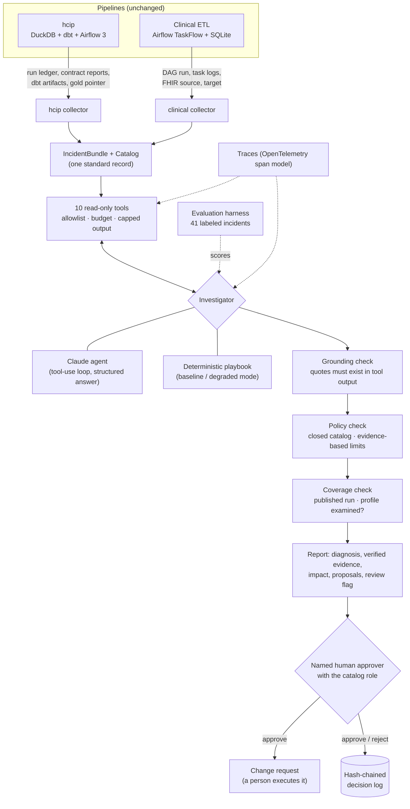
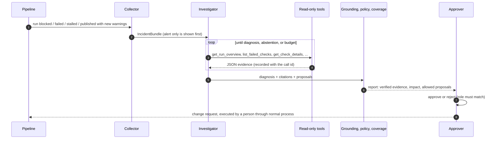

# Architecture

## System view

Nothing to the right of the collectors can reach a pipeline, its storage, or the network, except the
Claude agent's call to the model API.

## Components

| Module | Responsibility |
| --- | --- |
| `drc.models` | Incident, Evidence, Catalog, Diagnosis, Citation, Proposal, Investigation |
| `drc.collectors.hcip` | Reads hcip's DuckDB ledger read-only, contract reports, compiled dbt tests (re-runs them read-only against the kept candidate database for failing rows), dbt `manifest.json` lineage, the gold pointer; profiles both deliveries with the same pinned CSV dialect hcip uses |
| `drc.collectors.clinical` | Reads an Airflow-shaped DAG run record, profiles FHIR-shaped bundles (field paths, unresolved references, naive timestamps), reads the SQLite target with `mode=ro` |
| `drc.tools` | The ten read-only tools, a closed allowlist, a call budget, 9,000-character output cap, and a ledger of every call's exact output |
| `drc.agents.claude` | Tool-use loop on the Claude API: strict tools, JSON-schema final answer, caching, refusal fallback, forced final turn |
| `drc.agents.baseline` | The deterministic playbook (control and degraded mode) |
| `drc.grounding` | Verifies citations against the call ledger; withholds diagnoses with no verified evidence |
| `drc.policy` | Validates proposals against the catalog and the recorded publish state |
| `drc.coverage` | Flags a diagnosis for review when this run's output reached consumers and the delivery's column profile was not examined; replays over recorded investigations |
| `drc.approval` | Role-checked decisions, hash-chained log, change requests |
| `drc.evaluation` | Runs the benchmark, scores against labels, enforces regression gates, replays the coverage check over published results |
| `drc.tracing` | Spans for each investigation, model turn, tool call, and guardrail |
| `drc.lab` | Re-creates the benchmark by running the real pipelines against injected faults |

## Investigation lifecycle

## Incident signals

| Signal | hcip | Clinical ETL |
| --- | --- | --- |
| `run_blocked` | a contract or dbt audit gate stopped the publish (write-audit-publish kept the previous gold) | - |
| `run_failed` | an unexpected error in a step | any failed task (Airflow marks the DAG run failed) |
| `run_stalled` | a run with no finish record | - |
| `published_with_warnings` | the run published, and a warning appeared that did not fire on the previous published run | - |

Warnings that also fired on the previous published run are recorded as such, not alerted on.

## Model and cost controls

See [ADR 0005](adr/0005-agent-loop-on-the-claude-api.md). In short: `claude-opus-5-5` at `high` effort,
24 tool calls maximum, final answer constrained to the taxonomy and the remediation catalog, prompt caching
on the static prefix, per-incident cost computed from token usage (`drc.pricing`), and a spend cap on
evaluations (`drc eval --max-cost`). Measured: $0.091 and 22 seconds per incident (median).

## Target deployment (roadmap)

Release 1 runs as a CLI and in CI. The intended production shape, using services that match where the
pipelines would run:

| Concern | Release 1 | Target |
| --- | --- | --- |
| Trigger | `drc investigate` / `drc collect` by hand | Pipeline failure event (Airflow `on_failure_callback`, Fabric or ADF alert via Azure Monitor) to a queue |
| Compute | Local process | Containerized job (Azure Container Apps job or equivalent), one investigation per message |
| Collectors | hcip (DuckDB ledger), clinical (Airflow-shaped record) | + Airflow REST API, Fabric/ADF run history, Databricks jobs |
| Secrets | `ANTHROPIC_API_KEY` in the environment | Key vault with managed identity |
| Traces | JSON lines in the OpenTelemetry span model | OTLP export to the team's observability backend |
| Decisions | Hash-chained JSON lines file | Database table with the head hash anchored in the ticketing system |
| Approval | CLI with an asserted role | Ticket or chat workflow with identity-provider roles |
